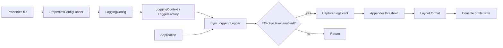

# logfk — logging framework design

Status: initial design for discussion, 2026-10-19. Implementation has not started.
Java 21, plain Java, no logging dependencies. Keep the first version in package
`logfk`; split implementation packages only when a second backend needs them.

## Goal and scope

Build an educational logging framework with a stable application API, a small
Logback-inspired synchronous backend, and configuration included from the start.
Then explore an asynchronous backend and measure its tradeoffs. This is our own
API, not an implementation of the actual SLF4J interfaces.

The user requested the package, abstractions first, configuration, and two phases.
The synchronous first version, properties format, explicit initialization, and
details below are proposed implementation choices, open to revision.

SLF4J supplies a facade that can delegate to different providers; Logback separates
loggers, appenders, and layouts. We borrow these boundaries, not their full APIs:
[SLF4J manual](https://slf4j.org/manual.html),
[Logback architecture](https://logback.qos.ch/manual/architecture.html).

## Key abstractions

| Type | Kind | Responsibility |
|---|---|---|
| `Logger` | Interface | Named application handle: level checks and logging calls. Knows nothing about files or configuration parsing. |
| `LoggerFactory` | Interface | `Logger getLogger(String name)` and a class-based convenience overload. Allows a later backend to supply the same API. |
| `Level` | Enum | `TRACE`, `DEBUG`, `INFO`, `WARN`, `ERROR`, `OFF`; explicit severity comparison. `OFF` is a configuration threshold, not an event level. |
| `LogEvent` | Record | Captured timestamp, level, logger name, caller thread name, rendered message, and optional rendered exception text. No mutable arguments cross backend boundaries. |
| `Appender` | Interface, `AutoCloseable` | Deliver one event to an output destination; `append(LogEvent)` and idempotent `close()`. Concrete appenders own their output resources. |
| `Layout` | Interface | `String format(LogEvent event)` turns an event into text; independent of destination. |
| `LoggingConfig` | Immutable record | Root level, logger-level overrides, and ordered named appender specifications. Defensive copies of collections. Contains descriptions, not open writers. |
| `PropertiesConfigLoader` | Class | Parse and validate a properties file into `LoggingConfig`; no output resources or global state. |
| `LoggingContext` | Class, implements `LoggerFactory`, `AutoCloseable` | Own configuration, logger cache, appenders, injected `Clock`, and lifecycle. Wire and release resources. |
| `SyncLogger` | Class, implements `Logger` | Apply effective level, render arguments once, capture the event, and dispatch synchronously through its context. |
| `ConsoleAppender`, `FileAppender` | Classes | Apply appender thresholds, format through an injected `Layout`, and serialize writes per appender. |
| `SimpleTextLayout` | Class, implements `Layout` | Fixed UTC timestamp / thread / level / logger / message format; append exception text when present. |

Use interfaces where behavior will vary. Configuration and events are data;
they do not need interfaces. Start without a provider registry, abstract logger
base class, general filter chain, or configuration-provider interface.

### Application contract (proposed signatures, not implemented code)

```java
public interface Logger {
    String name();
    boolean isEnabled(Level level);
    void log(Level level, String template, Object... arguments);
    void log(Level level, Throwable cause, String template, Object... arguments);
    // default trace/debug/info/warn/error(String, Object...) delegate to log(...)
}

public interface LoggerFactory {
    Logger getLogger(String name);
    default Logger getLogger(Class<?> type) {
        return getLogger(type.getName());
    }
}
```

An exception is supplied explicitly, for example
`logger.log(Level.ERROR, exception, "Order {} failed", orderId)`.
Do not infer an exception from the last argument. `{}` substitution happens only
after the logger-level check. Java still evaluates argument expressions and may
allocate the varargs array before calling us; guard expensive work with
`isEnabled`. Supplier overloads can follow later.

## How the parts work together



1. Bootstrap explicitly loads configuration and constructs a context. No static
   singleton or classpath discovery in phase one. Inject the context as a
   `LoggerFactory` into application components.
2. `getLogger` caches one handle per name within a context using
   `ConcurrentHashMap.computeIfAbsent`. Names should be stable class/package names.
3. A logger resolves its effective threshold once because configuration is fixed
   for the lifetime of its context. Closest dot-separated ancestor wins:
   `shop.orders.Checkout` -> `shop.orders` -> `shop` -> root.
   `shop.order` does not match `shop.orders`. An explicit `OFF` disables that branch
   unless a more specific override enables it.
4. A disabled call returns before rendering, reading the clock, or creating an event.
5. An enabled call captures caller metadata and renders arguments/exception text
   once; the same event is sent to each configured appender in declaration order.
6. An appender may reject the event by its own threshold; otherwise it formats and
   writes it. Logger and appender thresholds both apply. There is one context-wide
   destination list: no ancestor-appender propagation or additivity in phase one.

## Configuration from day one

Support one explicitly supplied UTF-8 `.properties` file, read with a `Reader`,
and the same typed `LoggingConfig` through a programmatic constructor.

```properties
root.level=INFO
logger.shop.orders.level=DEBUG
logger.shop.noisy.level=OFF
appenders=console,file

appender.console.type=CONSOLE
appender.console.level=TRACE
appender.console.layout=TEXT

appender.file.type=FILE
appender.file.level=WARN
appender.file.layout=TEXT
appender.file.path=logs/application.log
```

- No-argument default configuration: root `INFO`, one console appender targeting
  `System.err`, threshold `TRACE`, layout `TEXT`.
- A supplied file must declare `root.level`, `appenders`, and each appender's
  `type`. Appender level defaults to `TRACE`, layout to `TEXT`. `FILE` requires a
  nonblank path; resolve relative paths against the configuration file's directory.
  Programmatic relative paths resolve against the working directory.
- Reject unknown keys/types/levels/layouts, blank logger names, missing references,
  repeated appender names, duplicate property keys, and empty destination lists.
  Detect duplicate keys during loading before `Properties` overwrites them.
- Only `CONSOLE`, `FILE`, and `TEXT` initially. Logger keys have the grammar
  `logger.<name>.level`; appender names use `[A-Za-z][A-Za-z0-9_-]*`.
  Root is configured only by `root.level`. A file path on a console appender is invalid.
- Validate all settings before opening resources. Reject two file appenders with
  the same normalized absolute path; filesystem aliases and symlinks are outside
  this exercise's detection guarantee. Each appender uses its own layout instance.
- File output is UTF-8, append mode; create parent directories. Flush after each
  accepted event for the first implementation. Flush is not an fsync guarantee.
- If construction fails while opening an output, close resources already opened
  by that attempt and fail initialization. Creating directories/files is not
  transactional. A missing explicitly requested file is an error.
- Configuration is startup-only. Construct a new context to change it; hot reload,
  XML/YAML, pattern syntax, and environment substitution are deferred.

Example behavior: DEBUG from `shop.orders.Checkout` goes only to console; WARN
goes to console and file; DEBUG from `shop.inventory.Stock` is rejected by root.

## Correctness and lifecycle

- Levels use explicit severity values; `isEnabled(OFF)` is false, and logging an
  event at `OFF` is invalid. Null required inputs fail fast; blank logger names
  fail validation. Empty messages are valid. Null argument elements render `null`.
- Replace `{}` left-to-right, preserve unmatched placeholders, and append surplus
  arguments in brackets. No escaping or reflective object expansion initially.
  Contain `RuntimeException` from an argument's `toString()` using a fallback text.
  Repeated logging calls are distinct events, including identical timestamps.
- Render exception text on the calling thread. Events hold strings and value types,
  not `Throwable` or caller-owned arrays. Mutable arguments must not be mutated
  concurrently by the application while their text is being captured.
- Share immutable configuration safely; use per-appender locks around each full
  event write and flush. Layouts must be thread-safe; the first layout is stateless.
  Separate contexts must not concurrently write the same file in phase one.
- A context lifecycle read/write lock covers dispatch versus close. Logging holds
  the read lock through delivery; close takes the write lock, waits for active
  calls, marks the context closed, then closes every appender. Subsequent log calls
  are no-ops; `getLogger` after close fails with `IllegalStateException`.
  Close is idempotent and attempts all resource closures even if one fails.
- Each appender preserves whole-event writes. Concurrent calls have no global
  ordering guarantee, and different destinations may observe different orders.
- Invalid API/configuration inputs throw. Operational write/format failures report
  directly to an injected internal error handler (default stderr), then continue
  to other appenders. The handler must not use this logging pipeline; failures
  from the handler are contained. Fatal JVM errors are not swallowed.
- Closing console output flushes without closing `System.err`; closing file output
  releases the owned writer. Appenders and context make duplicate close harmless.

## Build in small increments

1. **Contracts:** `Level`, `Logger`, `LoggerFactory`, `LogEvent`, `Appender`,
   `Layout`, and typed configuration. Review boundaries before adding I/O.
2. **Small working pipeline:** synchronous context/logger, fixed text layout,
   console output, programmatic config, deterministic demo with injected `Clock`.
3. **Configurable backend:** properties loading, inherited levels, file output,
   startup failure cleanup and shutdown. Add focused tests as behavior arrives.
4. **Phase two:** prototype bounded async delivery behind the same `LoggerFactory`.
   Capture events before enqueueing; decide block/drop policy, counters, interruption,
   worker failure, and shutdown drain deadline before implementing the queue.
   Compare caller latency, throughput, delivery loss, and memory against phase one.

Phase-two candidates, not commitments: JSON layout, context fields (MDC), batching,
rotation, lazy suppliers, hot reload, and a real SLF4J provider. Async is better for
some workloads, not automatically: queues add lag and failure modes.

## Interview critique and checks

- **Complexity:** cached logger lookup is expected O(1); first-time level resolution
  walks name ancestors. Disabled logging is O(1). Enabled delivery is
  O(A * (M + T)) plus I/O for A appenders, message length M, and exception text T;
  temporary space O(M + T), cached state O(L + C + A) for L logger names and C rules.
  String slicing during first resolution can cost O(N * D), name length N and
  ancestor depth D; do not claim that path is constant time.
- **Concurrency:** map safety alone does not make writer access or shutdown safe;
  protect whole writes and serialize close against in-flight delivery. No total
  order, durable delivery, or exactly-once guarantee.
- **Edge cases:** level boundaries/OFF, dot-boundary inheritance, empty/null messages,
  placeholder mismatch, faulty `toString`, concurrent writes, duplicate close,
  unwritable files, partial initialization, and one failing destination.
- **Scale:** blocking I/O and per-event flush cap throughput; bounded async delivery
  and batching trade caller latency for lag/loss policy. Unbounded logger names and
  file growth require stable names and rotation/retention respectively.
- **Alternative:** use real SLF4J plus a maintained backend in production; building
  this exposes the internals but costs compatibility, operational features, and tuning.
- **Verification when implemented:** focused JUnit tests for thresholds/inheritance,
  formatting, config validation, independent contexts, failure isolation, whole-event
  concurrent writes, and close races; compile and run the demo. This design has no
  runtime implementation to verify yet.
