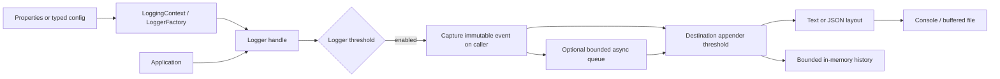

# logfk — Java logging framework

Implemented 2026-10-20 with Java 21 and the standard library. This is an educational
framework with its own API, inspired by the facade/backend separation in
[SLF4J](https://slf4j.org/manual.html) and [Logback](https://logback.qos.ch/manual/architecture.html).
It does not implement the actual SLF4J provider interfaces.

## Run it

From the repository root in PowerShell:

```powershell
mvn test
java -cp target/classes logfk.Main
java -cp target/classes logfk.Main src/main/java/logfk/logfk.properties
```

No arguments uses root INFO and synchronous stderr output. The supplied
`logfk.properties` enables DEBUG for the demo, text console output, and buffered
JSON file output through a bounded asynchronous queue. The file is
`target/logfk-demo/application.jsonl`; repeated runs append. The exception in the
demo is a logged sample, not a failing application run. No automatic shutdown hook:
the application owns the context and closes it with try-with-resources.

Run only the framework tests with `mvn '-Dtest=logfk.*Test' test`.
Surefire is pinned in the root POM so normal `mvn test` discovers JUnit 5 tests.

## Use it

```java
try (var context = new LoggingContext()) {
    Logger logger = context.getLogger(MyService.class);
    logger.info("Order {} accepted for {}", orderId, customerId);
    logger.debug("Details: {}", details);
    logger.error("Order failed", exception);
    // Exception plus arguments: explicit cause; never infer a trailing Throwable.
    logger.log(Level.ERROR, exception, "Order {} failed", orderId);
    context.flush();
}
```

Inject `LoggerFactory` into application components; `LoggingContext` is its
implementation and resource owner. Named loggers are cached within each context.
There is no global singleton, so independent applications/tests can use independent
settings. The five original single-String methods remain available.

Programmatic configuration:

```java
var file = AppenderConfig.file("file", Path.of("target/orders.jsonl"))
        .withLevel(Level.INFO)
        .withLayout(AppenderConfig.Format.JSON)
        .withBuffering(8192, false)
        .withAsync(new AsyncConfig(1024, OverflowPolicy.BLOCK, Duration.ofSeconds(5)));
var config = new LoggingConfig(Level.INFO, Map.of("shop.orders", Level.DEBUG),
        List.of(AppenderConfig.console("console"), file));
try (var context = new LoggingContext(config)) {
    context.getLogger("shop.orders.Checkout").info("configured");
}
```

For custom destinations or deterministic tests, the other context constructor
accepts root level, named overrides, an ordered map of `Appender` instances,
`Clock`, and `ErrorHandler`. The context adopts those appenders. Do not share their
ownership or concurrently write the same file through different contexts.
`getAppender(name)` exposes counters/history; it does not transfer ownership.

## Abstractions and source-reading order

| Type | Responsibility |
|---|---|
| `Logger`, `LoggerFactory`, `Level` | Application methods, named handle lookup, threshold comparison. |
| `LogEvent`, `MessageFormatter` | Capture caller metadata, substitute arguments, render exceptions once. |
| `Layout`, `SimpleTextLayout`, `JsonLayout` | Event-to-text formatting, independent of destination. |
| `Appender` | Thread-safe append/flush/close contract. |
| `WriterAppender` | Serialize whole-record formatting/writing, own or borrow a Writer. |
| `ConsoleAppender`, `FileAppender` | Checked stdout/stderr writes; buffered UTF-8 append-mode file writes. |
| `InMemoryAppender` | Bounded event history with oldest-event eviction and immutable snapshots. |
| `AsyncAppender` | Decorate any appender with a bounded FIFO queue and one daemon worker. |
| `AppenderConfig`, `AsyncConfig`, `LoggingConfig` | Immutable, validated startup descriptions. |
| `PropertiesConfigLoader` | Strict properties parsing; no resources opened while parsing. |
| `LoggingContext`, `SyncLogger` | Wiring, inheritance, caching, dispatch and lifecycle ownership. |
| `ErrorHandler`, `InternalErrors`, `CallbackGuard` | Isolated diagnostics and callback recursion/deadlock protection. |



## Levels and messages

- TRACE < DEBUG < INFO < WARN < ERROR. OFF is a threshold that disables output;
  attempting to emit an OFF event throws `IllegalArgumentException`.
- Root defaults to INFO. Closest dot-separated logger override wins:
  `shop.orders.Checkout` -> `shop.orders` -> `shop` -> root. `shop.order` does not
  match `shop.orders`. A more specific override may enable a child below an OFF parent.
- Logger and destination thresholds both apply. `isEnabled(level)` checks the
  logger threshold and context state, not every appender's threshold/queue capacity.
- Every logger uses the same ordered destination list. There is no parent-appender
  propagation/additivity or per-logger destination routing in this version.
- `{}` substitution is literal and left-to-right. Missing arguments leave `{}`;
  extras are appended in brackets. Null argument elements render `null`. No escaping,
  lookups or reflective expansion. Faulty `toString()` gets fallback text.
- Null templates/argument arrays/required collaborators are rejected; empty messages
  and repeated calls are valid. Disabled calls skip event creation and rendering,
  but Java still evaluates argument expressions and may allocate a varargs array.
  Guard expensive expressions using `isEnabled` until supplier methods are added.
- Timestamp, thread name, message and exception text are captured on the caller.
  Events retain no caller-owned arrays or Throwable objects. Do not mutate arguments
  concurrently while their text is being captured.

## Destinations and buffering

| Destination | Behavior |
|---|---|
| Console | stdout or stderr; immediate flush; never closes the borrowed stream. |
| File | UTF-8, append mode, parent-directory creation; configurable character buffer. |
| Memory | Retains the last N immutable events; counts oldest-event evictions. |
| Custom | Implement `Appender`, or inject a Writer/Layout into `WriterAppender`. |

Two independent buffering layers:

1. **Writer buffering:** `bufferSize` is characters, default 8192. With
   `immediateFlush=true` (default), each file event flushes. With false, a full
   buffer, explicit context flush, or close pushes buffered text out. There is no
   periodic timer flush. Flushing is not fsync and does not promise crash durability.
2. **Async event queue:** `async=true` adds a worker per destination. Capacity bounds
   pending entries, plus at most one in-flight entry, not total bytes. `BLOCK` waits
   for space; `DROP_NEWEST` discards the new event and increments its counter.
   The underlying destination threshold is evaluated by the worker, after admission.

An async flush uses a non-droppable FIFO barrier, not a queue-empty poll. It waits
for preceding work and flushes its delegate. `acceptedCount` counts queued events;
`deliveredCount` counts successful delegate append calls (including calls the
delegate filters by threshold); `failureCount` counts operational append/flush
failures; `droppedCount` counts overflow, interrupted admission, same-worker
recursion, or work abandoned after worker failure. Calls after stop are ignored,
not counted as drops. Counters are process-local and are not durable-delivery metrics.
Memory-appender eviction is a separate counter.

## Configuration

The example file includes all major settings. Minimal supplied configuration:

```properties
root.level=INFO
logger.shop.orders.level=DEBUG
logger.shop.noisy.level=OFF
appenders=console,file,memory
appender.console.type=CONSOLE
appender.console.target=STDERR
appender.file.type=FILE
appender.file.path=logs/application.jsonl
appender.file.level=WARN
appender.file.layout=JSON
appender.file.bufferSize=8192
appender.file.immediateFlush=false
appender.file.async=true
appender.file.queueCapacity=1024
appender.file.overflowPolicy=BLOCK
appender.file.shutdownTimeoutMillis=5000
appender.memory.type=MEMORY
appender.memory.capacity=1000
```

- Files are explicit UTF-8 input. Relative output paths resolve against the config
  file directory; programmatic paths resolve against the working directory.
- Required: root level, appender list, each type, and FILE path. Appender level
  defaults TRACE; layout defaults TEXT; console target defaults STDERR; memory
  capacity defaults 1000. Async defaults false; enabled async defaults capacity
  1024, BLOCK, shutdown wait 5000ms. Names use `[A-Za-z][A-Za-z0-9_-]*`.
- Enums are uppercase and booleans are exactly `true`/`false`. Positive capacities
  and durations are checked for range/overflow. Memory stores events, so it has no
  layout option. Console has no file-buffer options; async-specific options require
  `async=true`. Unknown or inapplicable properties are rejected.
- Reject duplicate keys (including escaped equivalent keys), duplicate appender names,
  empty destination lists, malformed logger names, and duplicate normalized absolute
  file paths. Filesystem aliases/symlinks are outside duplicate-path detection.
- Validate settings before opening destinations. If opening a later output fails,
  close earlier opened outputs/workers. Directory/file creation is not transactional.
- Settings are immutable for a context's lifetime. No classpath auto-discovery,
  hot reload, pattern parser, environment substitution or XML/YAML in this version.

## Concurrency, shutdown and failure contracts

- Per-appender locks preserve complete records; a worker preserves its FIFO admission
  order. Concurrent producers have no universal ordering across destinations.
- Context flush is a per-destination fence for logging calls completed before flush
  began. Concurrent calls may cross the fence; it is not an atomic multi-sink snapshot.
  Flush waits on destination locks/barriers without holding the context lifecycle lock.
  A flush begun after context close starts is a no-op, even if a timed-out worker is
  still draining; explicitly wait on that AsyncAppender if needed.
- Close marks the context closed and stops async admission before waiting for active
  dispatch, so blocked producers wake. Workers drain already accepted entries and close
  their own delegates. New/existing logger calls after close are no-ops;
  `isEnabled` returns false and factory lookup fails. Resource close is attempted once.
- Each async close waits up to its configured deadline. Timeout throws IOException;
  its daemon worker continues draining and owns eventual resource cleanup. The caller
  never closes a writer under an active worker. A context aggregates errors and still
  attempts all other destination closes. Context close is idempotent, including after
  failure; retry an exposed AsyncAppender's close if you need to wait again.
- **Deadline limit:** synchronous writes/flushes and application formatting callbacks
  can block indefinitely; this is not a hard deadline for the whole context. Async
  deadlines are per destination, not one shared total budget. BLOCK is backpressure;
  use DROP_NEWEST if producer latency matters more than retaining every event.
- Interrupted queue admission restores the interrupt flag, rejects that event and
  reports a failure. Operational append failures report to ErrorHandler and do not
  stop other destinations; flush/close failures are also returned as IOException.
  No retries. Fatal JVM Errors propagate; a failed worker releases waiting barriers.
- Logging from rendering/delivery/error callbacks is suppressed to prevent recursion.
  Factory lookup and context flush/close from callbacks fail before acquiring locks,
  preventing lock upgrades and worker-to-context deadlocks. Custom destinations and
  handlers must not route their own diagnostics through this pipeline.

## Verification and critique

Verified with `mvn clean test`: 64 tests passed, including 23 framework checks.
Both demo modes ran; the configured demo's three output lines parsed as valid JSON
with levels INFO, WARN and ERROR, verifying the file's threshold.

Tests exercise level boundaries/OFF, named overrides/cache, placeholder edge cases,
caller snapshots, JSON escaping, file buffering/UTF-8/append, bounded retention,
configuration validation, failure isolation, concurrent records, queue policies,
interruption, partial startup cleanup, callbacks, drain and close/flush races.
Implementation critique is in the headers of LoggingContext, WriterAppender,
InMemoryAppender, AsyncAppender and PropertiesConfigLoader.

Cached lookup is O(N) including name validation; disabled logging is O(1).
First lookup can cost O(N*D) for name length N/depth D. Enabled work is O(A*(M+T)) plus I/O for A destinations,
message length M and exception length T. Buffers bound event count, not message size;
logger names and file growth are unbounded. No throughput or latency claims have
been measured. This is a demonstrated reference implementation, not an independent solve.

## Recommended expansions

1. **File rotation and retention:** size/time policies, concurrent rollover and disk limits.
2. **Structured context:** request/trace IDs, scoped MDC cleanup and executor propagation.
3. **Async batching and timer flush:** compare throughput, tail latency and drop rate in
   a separate performance lab; record JDK, workload, environment and measurement limits.
4. **Suppliers and fixed-arity overloads:** reduce disabled-call allocations and avoid
   expensive argument evaluation without introducing ambiguous exception overloads.
5. **Atomic configuration reload:** publish snapshots and safely retire old writers/workers.
6. **Real SLF4J provider integration:** exercise the same backend using the standard facade.

Later: per-logger routing/filters, redaction, collector/network appenders with bounded
retry and failure budgets. Keep durable audit logging as a separate contract.
